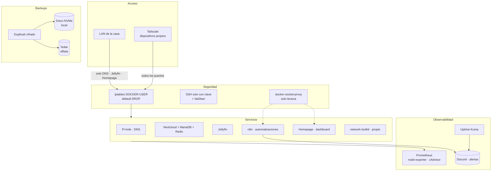

# 🖥️ homelab

Servidor Linux doméstico que administro como si fuera de producción: servicios en contenedores, red cerrada, backups cifrados y monitoreo con alertas.

> *Self-hosted home server run like production: containerized services, locked-down network, encrypted backups and alerting.*

| | |
|---|---|
| **Hardware** | HP EliteDesk 705 G5 SFF · Ryzen 5 PRO 3400G · 16 GB DDR4 · NVMe 256 GB + HDD 1 TB |
| **SO** | Ubuntu Server 26.04 LTS · unattended-upgrades + Livepatch |
| **Contenedores** | 23 contenedores en 13 stacks, Docker Compose a mano (sin Portainer) |
| **Acceso** | Tailscale (VPN mesh). Nada de administración expuesto a Internet |

---

## Arquitectura

## Red y seguridad

- **Firewall en la cadena correcta.** Docker se saltea UFW al publicar puertos, así que el filtro va en `DOCKER-USER` usando `--ctorigdstport`, porque el paquete ya pasó por DNAT. Desde la LAN solo se ven DNS (53), Jellyfin (8096) y Homepage (8083); todo lo demás es accesible únicamente por Tailscale. Ver [`firewall/`](firewall/).
- **Socket de Docker protegido.** n8n y Homepage leen el estado de los contenedores a través de [`docker-socket-proxy`](stacks/docker-proxy/) en una red `internal`, con `POST=0`: pueden mirar, no tocar.
- **Contenedores endurecidos** donde se puede: `read_only`, `cap_drop: [ALL]`, `no-new-privileges` y límites de memoria. Ver [`discord-bot`](stacks/discord-bot/) y [`quartz-brain`](stacks/quartz-brain/).
- **SSH** solo con clave pública (contraseña deshabilitada) y fail2ban.
- **Secretos fuera del repo:** todo va por variables de `.env` (ver [`.env.example`](.env.example)).

## Servicios

| Stack | Qué hace |
|---|---|
| [`pihole`](stacks/pihole/) | DNS con bloqueo de publicidad para toda la casa |
| [`nextcloud`](stacks/nextcloud/) | Nube privada (Nextcloud + MariaDB + Redis) |
| [`media`](stacks/media/) | Jellyfin para las teles de la casa |
| [`n8n`](stacks/n8n/) | Automatizaciones: alertas, reporte diario y bot de Discord |
| [`homepage`](stacks/homepage/) | Dashboard con el estado de todo |
| [`web-utils`](stacks/web-utils/) | Stirling-PDF e IT-Tools |
| [`network-toolkit`](stacks/network-toolkit/) | **Herramienta propia:** ping, traceroute, DNS, escaneo de puertos y de LAN, chequeo TLS, iperf3 y terminal SSH web. Corre 24/7 en el server y también en versión portátil para notebook |
| [`discord-bot`](stacks/discord-bot/) | Bot propio que manda pedidos de Discord a un webhook interno de n8n |
| [`quartz-brain`](stacks/quartz-brain/) | Sitio de notas estático con Caddy, publicado solo en la tailnet |

## Backups

- **Duplicati**, dos jobs diarios cifrados:
  - local, a otro disco físico (NVMe), para no depender del HDD de datos;
  - offsite, en la nube.
- **Dumps de MariaDB** diarios de Nextcloud con retención de 14 días, más heartbeat a healthchecks.io.

## Monitoreo y alertas

- **Uptime Kuma**: 14 monitores, con alertas a Discord.
- **Prometheus** + node-exporter + cAdvisor: métricas del host y de cada contenedor.
- **Reporte diario** automático armado con las métricas de Prometheus.
- **smartd**: alertas de salud de los discos a Discord.
- **healthchecks.io**: heartbeat cada 5 minutos para enterarme si el server entero se cae.

## Auditoría y próximos pasos

En noviembre de 2026 le hice una auditoría completa de solo lectura. Los hallazgos y el plan están en [`docs/auditoria.md`](docs/auditoria.md). Resumen honesto: la red está bien cerrada, pero el mantenimiento de las imágenes tenía deuda.

- [ ] Fijar versiones de imágenes en lugar de `:latest` y armar un proceso de actualización
- [ ] Sacar los secretos que quedaban en texto plano a `.env` y gestor *(hecho en este repo)*
- [ ] Avisos de fallo de Duplicati y **prueba de restore** periódica
- [ ] Reglas de alerta en Prometheus
- [ ] Rotación de logs y ajuste de cAdvisor
- [ ] UPS y ampliación a 32 GB de RAM

---

Hecho por [Gonzalo García Quiroga](https://github.com/gonzagq) · Mendoza, Argentina
